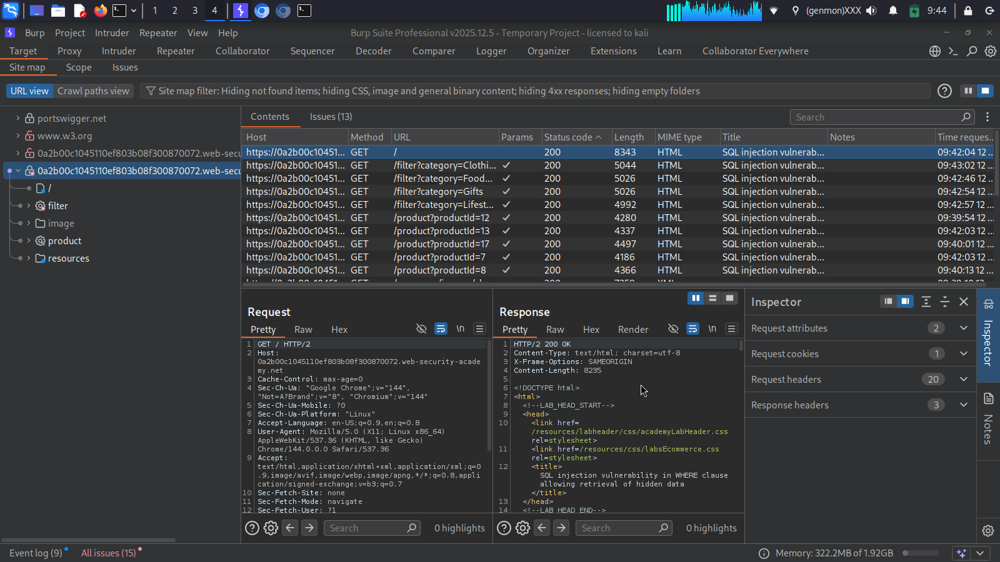

# Web Reconnaissance Report
## Brew & Bean Cafe

### 1. Objective
Perform basic web reconnaissance on a vulnerable demo
application using Burp Suite Professional.

### 2. Target
https://0a2b00c1045110ef803b08f300870072.web-security-academy.net/

### 3. Discovered URLs

1. https://0a2b00c1045110ef803b08f300870072.web-security-academy.net/
2. https://0a2b00c1045110ef803b08f300870072.web-security-academy.net/filter
3. https://0a2b00c1045110ef803b08f300870072.web-security-academy.net/filter?category=Clothing%2c+shoes+and+accessories
4. https://0a2b00c1045110ef803b08f300870072.web-security-academy.net/filter?category=Food+%26+Drink
5. https://0a2b00c1045110ef803b08f300870072.web-security-academy.net/filter?category=Gifts
6. https://0a2b00c1045110ef803b08f300870072.web-security-academy.net/filter?category=Lifestyle

### 4. Burp Suite Site Map Screenshot

### 5. Potential Vulnerability

Parameter: category

Endpoint: /filter

Potential Issue: SQL Injection

Suggested Test:
Submit a single quote (') in the category parameter
and observe whether the application returns an unexpected
error or response.

This is only a preliminary test and does not confirm
the presence of SQL injection.

### 6. Conclusion

Basic web reconnaissance was performed using Burp Suite.
Six distinct URLs were identified and documented.
